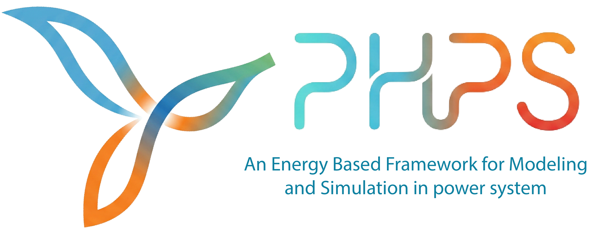
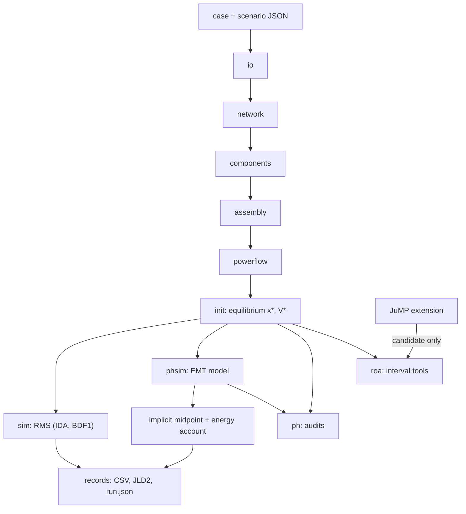

<div align="center">
  
  <br/>
  <sub><em>An electromagnetic-transient power-system simulator built on port-Hamiltonian models, written in Julia.</em></sub>
</div>

<br/>

[](https://julialang.org/)
[](LICENSE)
[]()

---

PHPS models every device by the energy it stores, the energy it loses and the ports through which it exchanges power
with the rest of the grid. The simulator integrates these models so that the energy balance holds at every time step,
for every component, to rounding error. The same model code also serves analysis: automatic differentiation,
interval arithmetic, passivity audits and optimisation.

> PHPS was first a Python/C++ simulator (versions 1 and 2). This is its successor, rewritten in Julia.

## Contents

- [What it provides](#what-it-provides)
- [Accuracy](#accuracy)
- [Quick start](#quick-start)
- [Documentation](#documentation)
- [Working with an AI assistant: the MCP server](#working-with-an-ai-assistant-the-mcp-server)
- [Design principles](#design-principles)
- [Architecture](#architecture)
- [Models](#models)
- [Inputs and outputs](#inputs-and-outputs)
- [Repository layout](#repository-layout)
- [Testing](#testing)
- [Glossary](#glossary)
- [License](#license)

## What it provides

- **EMT simulation in dq0 coordinates.** Stator and rotor fluxes, line currents and node charges are states, so
  electromagnetic transients are simulated, not averaged away.
- **An exact energy account.** Each time step balances, for every component, the change in stored energy against the
  power through its ports and its losses. In an IEEE 39-bus fault run the balance closes to about 1e-13 of the
  energy exchanged, so a model that creates or loses energy it should not shows up at once.
- **Physical device models:**
  - synchronous machines with all their rotor windings;
  - DC shunt and brushless exciters;
  - steam units with real water and steam properties (IAPWS-95), including reheat;
  - a hydro unit with an elastic penstock;
  - grid-following and grid-forming converters (VSM, droop, VOC) with their DC side;
  - pi-section and travelling-wave lines, transformers with saturating cores;
  - static and composite loads with induction motors.
- **Balanced and unbalanced faults.** Three-phase, phase-to-ground, phase-to-phase and two-phase-to-ground faults,
  through a zero-sequence network, cleared either at once or at each phase's current zero.
- **An RMS stack** for phasor studies: power flow, initialisation, IDA and BDF simulation with IEEE controllers
  (GENROU, GENSAL, IEEET1, IEEEG1, IEEEG3) and converters.
- **Analysis tools on the same models:** port-Hamiltonian structure and passivity audits, interval enclosures and
  Taylor models, JuMP programs for Lyapunov and storage problems.
- **An MCP server**, so an AI assistant can build models, run faults and read waveforms, the energy account and plots
  through fixed, checked tools.

## Accuracy

PHPS against DIgSILENT PowerFactory 2022 EMT on the IEEE 39-bus system: a three-phase fault at bus 16 through 0.001 pu
from 0.1 s to 0.2 s, exciters and governors in service in both tools.

Largest differences over all ten machines and all buses: rotor angle 0.010°, speed 1.1e-6 pu, electrical torque
0.1 % of its excursion, bus voltage 0.033 pu at the sharpest switching transient (0.04 % rms). The voltage peak at
the faulted bus after the fault is removed is 4.190 pu in PowerFactory and 4.194 pu in PHPS.

The comparison figures are in [docs/figures/](docs/figures) (PowerFactory black, PHPS orange dashed, fault shaded):
rotor angles (`accuracy_rotor_angle.png`), machine speeds (`accuracy_speed.png`), bus voltages
(`accuracy_bus_voltage.png`), and torques, fluxes and voltages at fault removal at 0.1 ms resolution
(`accuracy_fault_clearing.png`).

## Quick start

Install Julia 1.12 ([juliaup](https://github.com/JuliaLang/juliaup)), then in this folder:

```
julia --project -e "using Pkg; Pkg.instantiate()"
```

**A fault on the full physical IEEE 39-bus model** (three-phase at bus 16, 0.1 to 0.2 s), then the figures from the
stored run:

```
julia --project=. scripts/full_model_fault.jl --tstop=1
julia --project=. scripts/full_model_plots.jl
```

**From Julia:**

```julia
using PHPS

fm  = phs_full_model("cases/IEEE39Bus_FullModel")       # network, machines, exciters, turbines
run = phs_simulate(fm.cs, fm.x0, fm.u; tstop = 1.0, faults = fm.faults, save_dt = 1e-3)
phs_write_run("outputs/run.jld2", run)                   # states, bus voltages, energy account

# an unbalanced fault, phase a to ground, each phase cleared at its current zero
# (needs a model built with the zero-sequence network)
f = PHFault(16, 0.001, 0.1, 0.15; kind = :ag, clearing = :current_zero)
```

**An RMS run:**

```julia
sc  = load_scenario("cases/IEEE39Bus_PF/bus_fault_bus16_150ms.json")
eq  = solve_equilibrium(load_case(sc.system_path), sc)
res = simulate_ida(eq.sys, vcat(eq.x, eq.V); dt = sc.solver.dt, duration = sc.solver.duration)
```

## Documentation

[docs/](docs/README.md) holds the user guide and the API reference:

- [Getting started](docs/getting_started.md): installation, the first runs, where results go.
- [EMT simulation](docs/emt_simulation.md): building a model, its options, faults, running, the energy account,
  stored runs.
- [RMS simulation](docs/rms_simulation.md): cases, scenarios, power flow, initialisation, solvers, results.
- [Case files](docs/case_format.md): the system, scenario and full-model JSON formats.
- [Analysis tools](docs/analysis.md): port-Hamiltonian audits, interval tools, Lyapunov and storage programs.
- [Scripts](scripts/README.md) and the [MCP server](mcp/README.md).
- [API reference](docs/api/README.md): every exported function and type with its docstring, generated from the code.

## Working with an AI assistant: the MCP server

PHPS comes with a **Model Context Protocol (MCP) server**. An AI assistant such as Claude Code can use the simulator
through it: build a model, look at its operating point, run faults, and read the waveforms, the energy account and
plots. The assistant only calls the fixed tools below, whose arguments are checked; it never runs code through the
server.

### Start it

The server is registered as `phps` in [.mcp.json](.mcp.json). Open Claude Code in this folder and approve `phps` when
asked. First setup, once:

```
julia --project=mcp -e "using Pkg; Pkg.instantiate()"
```

By hand: `julia --project=mcp --startup-file=no mcp/server.jl` (the server speaks MCP on standard input/output).

### The tools

| Tool | What it does | Main arguments |
|---|---|---|
| `list_cases` | The cases and model options the server offers | none |
| `build_model` | Builds an EMT model of the IEEE 39-bus system and solves its operating point | `preset` (`ieee`: IEEE controllers; `full_physical`: physical exciters, steam and hydro units); `dc_exciter`, `brushless_exciter`, `steam`, `hydro` (switch each physical unit on or off); `loads` (`series_all`, `parallel`, `series`, `composite`); `lines` (`lumped` pi lines or `travelling`-wave lines); `unbalance` (zero-sequence network and its grounding); `machine_data` (full winding data or the case's GENROU data); `load_scale` (0.5 to 1.5); `parameter_changes` (e.g. `{"IEEET1_2": {"KA": 50}}`); `dry_run` |
| `operating_point` | Generator terminal voltage, active and reactive power, field voltage, speed and rotor angle; all bus voltages | `model_id` |
| `describe` | A model's components, or one component's parameters and states | `model_id`, `component` |
| `run_simulation` | Simulates a built model with faults; ends with a short summary of the run | `model_id`, `tstop`, `faults` (each: `bus`, `kind`, `R`, `Rg`, `t_on`, `t_off`, `clearing`); `save_dt`, `h`, `hscale`, `tol`; `max_wall_minutes`, `allow_long`, `dry_run` |
| `job_status` | State and progress of a build or run; waits up to 60 s for it to finish | `job_id`, `wait_seconds` |
| `cancel_job` | Stops a job; `force` restarts the simulation worker | `job_id`, `force` |
| `list_runs` | Built models and stored runs | none |
| `list_signals` | The signals stored in a run | `run_id`, `include_raw_states` |
| `get_signals` | Signal values: initial, lowest, highest and final with their times, and a table that keeps the peaks and the fault instants | `run_id`, `signals`, `t_from`, `t_to`, `max_points`, `reference_machine` |
| `energy_audit` | Energy balance of a run, per component and for the system | `run_id` |
| `plot` | Plots signals of one or more runs, one panel per unit, and returns the image | `run_ids`, `signals`, `t_from`, `t_to`, `reference_machine`, `title` |
| `delete_run` | Deletes a stored run and its plots | `run_id` |

**Fault kinds:** `abc` (three-phase), `abcg` (three-phase to ground), `ag`, `bg`, `cg` (phase to ground), `ab`, `bc`,
`ca` (phase to phase), `abg`, `bcg`, `cag` (two phases to ground). Faults to ground need a model built with
`unbalance` other than `none`. `clearing` is `instant` or `current_zero` (each phase opens at its own current zero).

**Signals:** `<machine>.speed` (pu), `<machine>.rotor_angle` (degrees), `<machine>.air_gap_power` (pu on 100 MVA),
`<machine>.terminal_voltage` (pu), `<machine>.field_voltage` (pu), `<machine>.turbine_power` (pu on 100 MVA),
`bus<k>.voltage` (pu), `<component>.energy`, and every state as `<state>.state`.

### How a session goes

1. `build_model` with `preset = "full_physical"`. The first build after the server starts takes about 20 s.
2. `operating_point` to check the dispatch and the voltages.
3. `run_simulation` with, for example, a three-phase fault at bus 16 from 0.1 to 0.15 s. Every run ends with a
   summary: the lowest bus voltage during the fault, the highest and lowest after clearing, the voltages at the end,
   the largest speed deviation and the energy balance.
4. `get_signals`, `energy_audit` and `plot` on the stored run.

### Safeguards

- Builds and runs are jobs with progress reports, so a tool call never hangs.
- Each run gets an estimated wall time first. A run estimated over `max_wall_minutes` (default 10) starts only with
  `allow_long`, which the assistant sets only after the user agrees. The limit is also enforced while the run goes.
- Wrong requests are refused with a plain reason before anything runs: a ground fault on a model without the
  zero-sequence network, a fault time outside the run, a change to a component's bus or rating.
- The simulator runs in its own worker process, so a crash cannot break the connection.
- Results are read from the stored run, never by simulating again. Everything is kept under `outputs/mcp/`:
  `models/<id>/` and `runs/<id>/` (`run.jld2` with states, bus voltages and the energy account; `run.json`; plots).

More in [mcp/README.md](mcp/README.md).

## Design principles

### 1. One model code for simulation and analysis

Each component is a set of plain Julia functions that are generic in the number type, so the same equations run with
every type below:

| Number type | Used for |
|---|---|
| `Float64` | power flow, simulation |
| `ForwardDiff.Dual`, sparse automatic differentiation | Jacobians, Newton, linearisation |
| intervals, interval jets, first-order Taylor models | enclosures, certificates, containment audits |

There is no second copy of a model for analysis, so there is nothing to keep in step.

Rules for component code:

- do not fix numeric arguments to concrete types such as `Float64`;
- do not use a bare `if` on a state-dependent value (see principle 2);
- `rhs!` must not allocate.

### 2. Limiters and branches are explicit

Every limiter, clamp, anti-windup or non-windup test, and guard is written with a small set of primitives instead of
`if`: `clamp_mode`, `nonwindup`, `select(cond, a, b)` and `guard_min`. Each primitive:

- on `Float64`, evaluates normally;
- on intervals, returns the branch it decided and the margin; a continuous limiter returns the clamped enclosure;
- reports its switching surface, so the simulator can find the switching instant.

### 3. The energy account is part of the model

Every EMT component declares its storage, its dissipation and its ports. The integrator (the implicit midpoint rule)
preserves the quadratic storage exactly, so each step's energy balance, per component and for the system, closes to
rounding error and is stored with the run. An energy error is a model error, not a numerical one.

### 4. Enclosures, not samples

Analysis results that claim a property for a whole region come from interval enclosures with outward rounding.
Optimisation (JuMP) output is a candidate until an enclosure confirms it, and sampling can find counterexamples but
never establishes a bound.

### 5. Every number can be traced

Every run writes a `run.json` that records hashes of the case, the scenario, the source (git commit plus a dirty
flag) and the Manifest, the solver settings and the wall time. Any number in a report can be traced back to the code
and inputs that produced it.

## Architecture



| Module | What it does |
|---|---|
| `io` | JSON schema validation; loaders for cases, scenarios and contracts; a safe parameter-expression reader (`"2.0 * M_PI * 60.0"`, never `eval`) |
| `network` | buses, lines, transformers (tap, phase shift), shunts, Y-bus, fault and topology events |
| `powerflow` | Newton-Raphson AC power flow with PV/PQ/slack handling |
| `components` | the RMS component interface, the limiter primitives, one file per model type |
| `assembly` | wiring from `connections`, port resolution, state layout, centre-of-inertia angle, the DAE residual and its sparsity pattern |
| `init` | power flow, then each component's initialisation, then one Newton solve of the full DAE for `(x*, V*)` |
| `sim` | IDA (Sundials.jl) and fixed-step BDF1; fault events; results writers and `run.json` |
| `phsim` | the EMT model: network, machines, exciters, steam and hydro units, converters, lines, transformers, motors, the zero-sequence network, fault clearing, the implicit midpoint integrator, the energy account, stored runs |
| `physical` | IAPWS-95 water and steam properties; the steam vessel, valve, turbine and rotor and their composition |
| `ph` | storage functions, port-Hamiltonian structure checks, port passivity, dissipativity, power balances |
| `roa` | interval core and jets, Taylor models, enclosures, Lyapunov candidates, containment audits, certificate records |
| `emdq` | reduced electromechanical dq models for stability analysis |

## Models

### EMT (`src/phsim/`)

| Family | Model |
|---|---|
| Machines | synchronous machines with all rotor windings (`PHMachine`), parallel units |
| Exciters | IEEE Type-1 control law, DC shunt exciter (`PHShuntExciter`), brushless exciter with rotating rectifier (`PHBrushlessExciter`) |
| Turbines and governors | IEEEG1 and IEEEG3 control laws; physical steam unit with IAPWS-95 properties and reheat (`PHSteamUnit`); hydro unit with elastic penstock (`PHHydroUnit`) |
| Converters | grid-following (`PHGfl`), grid-forming VSM (`PHVsm`), droop (`PHDroop`), virtual oscillator (`PHVoc`), with their DC side (`PHConverterDC`) |
| Network | pi-section and travelling-wave lines, transformers with saturating cores (`PHCore`), the zero-sequence network |
| Loads | constant impedance (parallel or series R-L), static loads and induction motors (`PHMotor`, `PHStatic`) |
| Events | `PHFault`: eleven fault kinds, cleared at once or at each phase's current zero |

### RMS (`src/components/`)

| Family | Types |
|---|---|
| Machines | `GENROU_PHTRUE`, `GENSAL_PHTRUE` |
| Exciter | `IEEET1_PHTRUE` |
| Governors | `IEEEG1_PHTRUE`, `IEEEG3_PHTRUE` |
| Load | `COMPLEXLOAD` |
| Grid-following converter | `GFL_PHTRUE` |
| Grid-forming converters | `GFM_VSM_PHTRUE`, `GFM_DROOP_PHTRUE`, `GFM_VOC_PHTRUE` |

Every RMS component is a subtype of `AbstractComponent` and implements:

| Function | Meaning |
|---|---|
| `state_names(c)`, `input_names(c)`, `output_names(c)`, `params(c)`, `ports(c)` | declared states, ports and parameters |
| `rhs!(dx, c, x, u, p)` | differential equations, generic in the element type |
| `outputs!(y, c, x, u, p)` | port outputs, for example `Efd`, `Tm` and currents |
| `injection(c, x, V, p)`, `norton_admittance(c)` | current injection into the network and its Norton admittance |
| `init_from_phasor`, `converter_init` | states from the power-flow solution |
| `hamiltonian(c, x)`, `grad_hamiltonian(c, x)` | declared storage and its gradient |
| `observable_names(c)`, `observable_values!` | derived signals written to results, such as `delta_deg` |
| `contract(c)` | the port-contract entry, including `domain_clauses` |
| `modes(c, x, u)` | the limiter and branch decisions (principle 2) |

## Inputs and outputs

**Inputs.** JSON case files, validated against the schemas in `cases/schema/`:

- system files: `config`, `Bus`, `PQ`, `PV`, `Slack`, `Line`, `Shunt`, `components`, `connections`;
- scenario files: `system`, `solver`, `events`, `output`, `plots`;
- for the full EMT model, `full_model.json` (the physical options) and `winding_circuits.json` (machine winding data).

The format is the one of the Python PHPS, so its cases load unchanged. See [docs/case_format.md](docs/case_format.md).

**Outputs.**

- RMS runs: `simulation_results.csv`, a JLD2 copy of the results, and `run.json`;
- EMT runs (`phs_write_run`): one JLD2 file with the whole state trajectory, bus voltages, the energy account per
  component, the declared records and the git commit;
- everything goes under `outputs/` (not in git).

## Repository layout

```
PHPS/
├── README.md
├── LICENSE
├── Project.toml            name, uuid, dependencies, extensions, compat
├── Manifest.toml           committed: the exact environment that every run record hashes
├── src/
│   ├── PHPS.jl             module, public API, includes
│   ├── io/  network/  powerflow/  components/  assembly/  init/  sim/     RMS stack
│   ├── phsim/              EMT simulator
│   ├── physical/           steam and shaft physics
│   ├── ph/  roa/  emdq/    analysis tools
│   └── precompile.jl       PrecompileTools workload
├── ext/                    loaded only with their heavy dependency
│   ├── PHPSJuMPExt/        Lyapunov, completion and conditioning programs (JuMP)
│   └── PHPSMakieExt/       reserved for plotting with CairoMakie (empty for now)
├── cases/                  system and scenario JSON; schema/ holds the JSON Schemas
├── contracts/              per-model port contracts
├── mcp/                    MCP server for AI assistants
├── scripts/                command-line entry points; build_api_docs.jl writes docs/api/
├── docs/                   user guide, API reference, figures
├── test/                   unit tests
└── .github/workflows/      CI
```

## Testing

```
julia --project -e "using Pkg; Pkg.test()"
```

The unit suite (about 10 000 checks, about half an hour) covers the loaders, the network and power flow, every RMS
component and primitive, assembly and solvers, the port-Hamiltonian audits, the interval tools, and the EMT
simulator: energy balance per step, step refinement against an independent BDF run, faults and their clearing,
converters, transformers, steam and hydro units. CI runs it on Linux and Windows for every push.

**Contribution rules.** A new component comes with its interface functions, its contract entry, a reference test at
random states with both sides of every limiter exercised, and an allocation test on `rhs!`. No bare `if` on
state-dependent values in component code.

## Glossary

| Term | Meaning |
|---|---|
| PH | port-Hamiltonian: `ẋ = (J − R) ∇H + g u`, where `H` is the storage, `J` the skew-symmetric interconnection and `R ⪰ 0` the dissipation |
| EMT | electromagnetic transient: a simulation that keeps the network's electromagnetic dynamics |
| RMS | phasor (root-mean-square) simulation, in which the network is algebraic |
| dq0 | the rotating reference frame with direct, quadrature and zero-sequence axes |
| Reservoir | a one-way accounting state that records the energy a source delivers; neutral, and left out of stability coordinates |
| Jacobian hull | interval enclosure of the Jacobian over a box |
| Krawczyk test | interval Newton test that proves a unique equilibrium exists in a box |
| Containment audit | proof that every limiter decision and every contract `domain_clause` holds on a box; it fails closed |
| COI, CCT | centre of inertia; critical clearing time |

## License

PHPS is not open source. Under the [PHPS License](LICENSE) you may use PHPS to build, simulate and analyse models and
publish your results (citing PHPS), and you may add models, tools or files to PHPS as long as the result stays
PHPS: same name, same license. **Commercial use is not permitted, no part of the code may be used in other
software, and PHPS may not be shared under any other name.** Anything else needs written permission; contact the
author through [GitHub](https://github.com/Rasoolpey).
