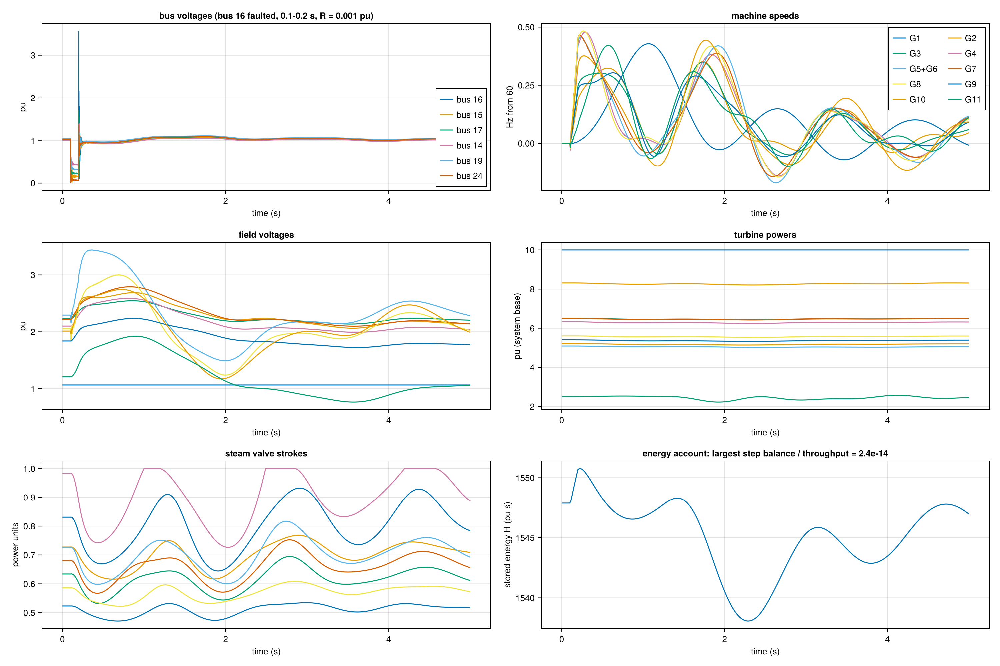
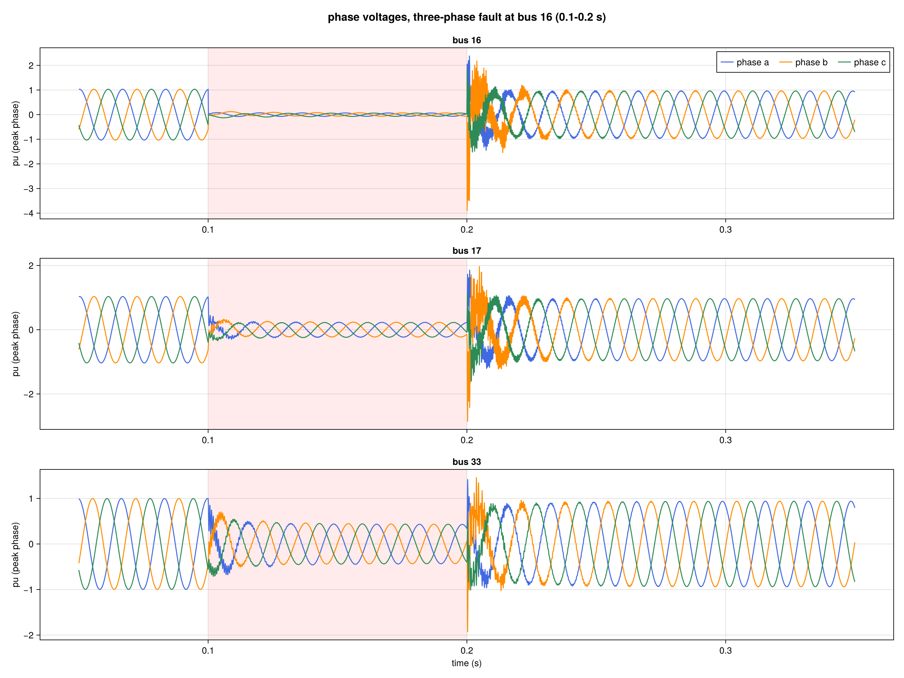
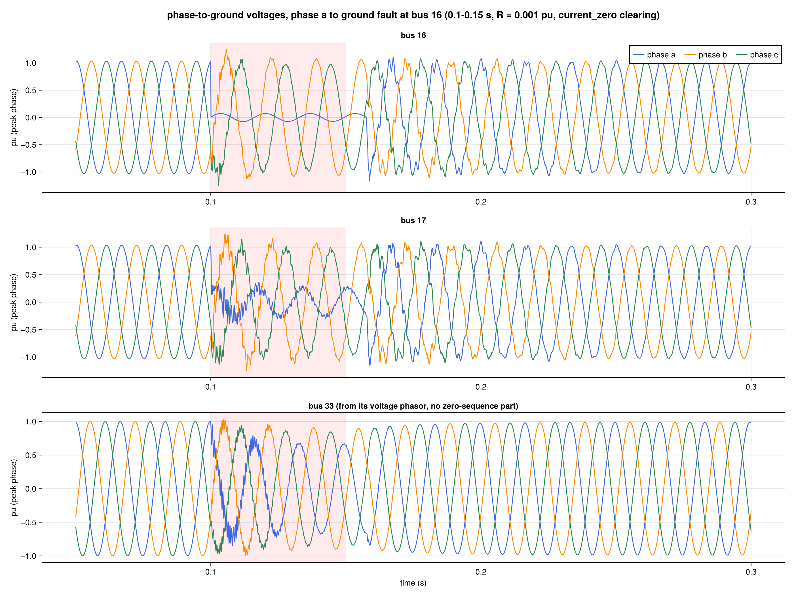
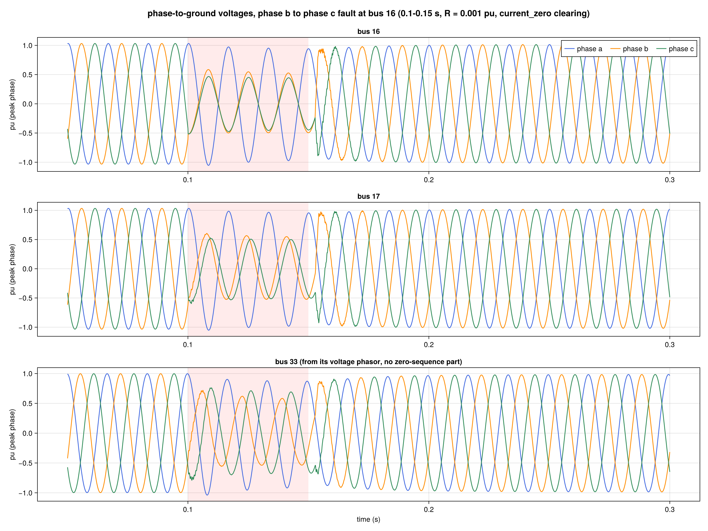
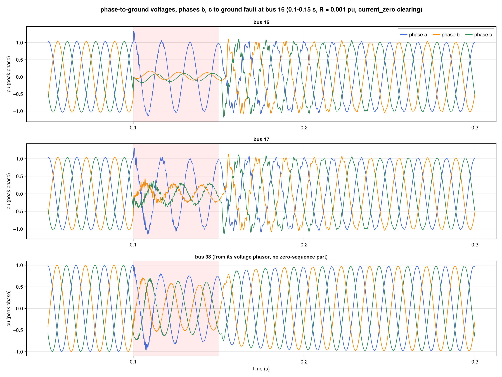
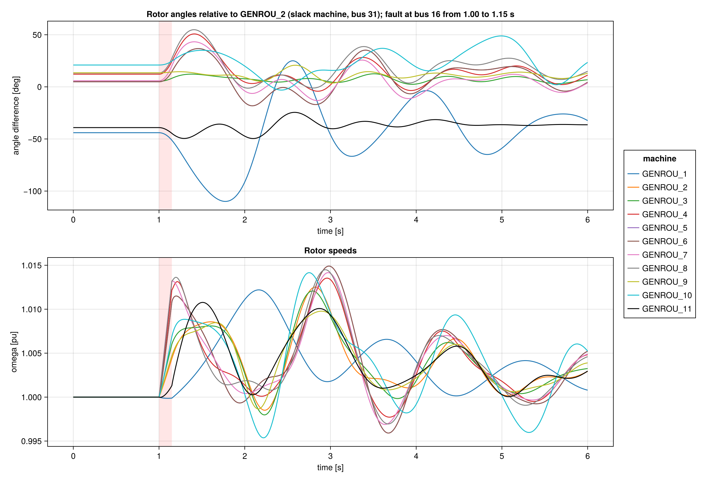
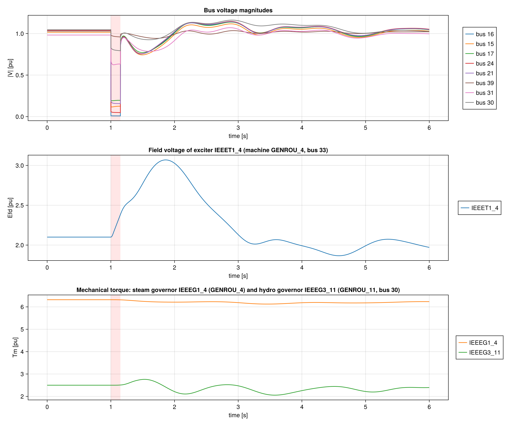
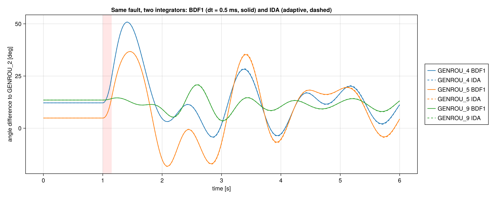

# Example figures

Figures from runs of the IEEE 39-bus system, with the commands that produced them. Everything else under `outputs/` stays
out of git; these show what the simulator gives. Run each command from the repository root. The
comparison with PowerFactory EMT is in [docs/figures/](../../docs/figures/README.md).

## EMT: the full physical model

`cases/IEEE39Bus_FullModel` uses full-winding machines, physical DC and brushless exciters, steam units with their steam
tables, a hydro unit with an elastic penstock, and a dynamic network. The fault is three-phase at bus 16 through
0.001 pu, from 0.1 s to 0.2 s. The model has 519 states and is solved with the implicit midpoint rule.

**`full_model_bus16_3ph_overview.png`**: 5 s after the fault. It shows the bus voltages, the machine speeds, the field
voltages, the turbine powers, the steam valve strokes and the stored energy. The energy account closes to 2.4e-14 of its
throughput.

```
julia --project=. scripts/full_model_fault.jl --tstop=5
julia --project=. scripts/full_model_plots.jl outputs/ph/full_model/fault_bus16_3ph_t5.0
```



**`full_model_bus16_3ph_phases.png`**: the instantaneous phase voltages a, b and c at the faulted bus 16, at bus 17
next to it, and at generator bus 33. The run is saved every 0.1 ms. The figure shows the collapse during the fault and
the high-frequency ringing when the fault is cleared.

```
julia --project=. scripts/full_model_fault.jl --tstop=0.4 --save_dt=1e-4
julia --project=. scripts/phase_waveform_plots.jl outputs/ph/full_model/fault_bus16_3ph_t0.4_dt0.0001 phases.png --buses=16,17,33
```



**Unbalanced faults**: the same model built with its zero-sequence network (`phs_full_model(...; dq0)`), which has 592
states. Each fault is at bus 16 through 0.001 pu from 0.1 s to 0.15 s, and each phase clears at its own current zero. The
figures show the phase-to-ground voltages at bus 16, at bus 17 and at generator bus 33. Bus 33 is on the delta side of its
step-up transformer, so it has no zero-sequence path; its phases come from its voltage phasor. Each run takes 25 to 40
minutes, since an unbalanced fault slows each step a lot.

| Figure | Fault | Command |
| --- | --- | --- |
| `full_model_bus16_ag_phases.png` | phase a to ground | `julia --project=. scripts/unbalanced_fault.jl --kind=ag --off=0.15 --tstop=0.3` |
| `full_model_bus16_bc_phases.png` | phase b to phase c | `... --kind=bc --off=0.15 --tstop=0.3` |
| `full_model_bus16_bcg_phases.png` | phases b and c to ground | `... --kind=bcg --off=0.15 --tstop=0.3` |







## RMS: the phasor model

`cases/IEEE39Bus_PF` has GENROU machines with IEEET1 exciters and IEEEG1/IEEEG3 governors. The fault is three-phase at
bus 16, applied at 1.0 s and cleared after 150 ms, and the run lasts 6 s. One command produces all three figures:

```
julia --project=. scripts/run_base_fault.jl
```

**`base_bus16_rotor.png`**: rotor angles relative to the slack machine GENROU_2, and rotor speeds.



**`base_bus16_voltages_controls.png`**: bus voltage magnitudes, the field voltage of exciter IEEET1_4, and the
mechanical torque of steam governor IEEEG1_4 and hydro governor IEEEG3_11.



**`base_bus16_bdf1_vs_ida.png`**: the same fault solved by two integrators, fixed-step BDF1 (0.5 ms) and adaptive IDA,
for three machines. The two solutions lie on top of each other.


